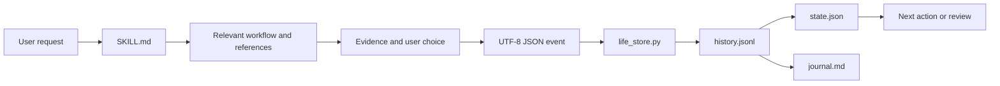

# Architecture / 架构

The skill is model guidance, not a scheduler. It selects a relevant workflow and separates user reports, estimates, suggestions, decisions and observed results. The helper validates event fields and state transitions; it cannot determine whether a statement is true. The model/user must maintain that distinction.

`history.jsonl` is authoritative. A write uses a lock and an expected revision, appends and flushes an event, then atomically replaces derived views. An old but consistent snapshot can be recovered from history. A manually altered snapshot, incomplete log tail or conflicting lock causes refusal, not reset. This is not a guarantee against every filesystem or hardware failure.

The original eight skill files are unchanged. Repository-only tooling verifies their hashes, installs without replacing a differing skill and builds a deterministic ZIP. Tests and demos use synthetic records in temporary directories. No personal record, transcript PDF, account token or private configuration is part of the distribution.

技能是模型行为指导，不是调度器。它按问题选择流程，并区分用户报告、估计、建议、决定和实际结果。助手验证字段与状态转换，不能自动判断内容真伪；分类由使用者负责。

日志是权威记录。写入先检查锁和版本，追加并刷新事件，再以原子替换生成视图。落后但一致的快照可由日志恢复；手工改动、不完整尾行和冲突锁会导致拒绝，不自动重置。不能据此保证任意硬件或文件系统故障下的数据恢复。

八个原技能文件未改变。仓库工具校验哈希、不覆盖不同安装并生成可重复 ZIP。测试和演示使用临时目录中的虚构记录，分发包不含个人资料、原 PDF、账户令牌或私人配置。

## Additive daily layer / 新增日常层

`ai-life-management-easy/assets/start.txt` is self-contained for chat-only use. The companion skill progressively loads the original theory and `interaction.md`. `daily.py` imports the frozen core, reads validated history, applies local-date selection (explicit `as_of` overrides recording date), and exports every selected-day event plus relevant baseline context. The model produces the interpretation; the adapter checks structured evidence references and saves Markdown/JSON reports. Report revisions archive old derived files and never append invented progress to core history. Packaging explicitly includes 14 files across both skills and RIGHTS.md.

通用提示词可独立用于纯聊天。日常技能按需读取原理论与交互说明。新增助手导入未改动核心，读取已校验日志，按本地日期选取完整当天事件（明确 `as_of` 优先于记录日期）及相关背景。模型负责解释，助手检查结构化证据引用后保存 Markdown/JSON 日报。修订归档旧派生产物，不向核心历史追加虚构进展。分发清单明确包含两个技能与权利说明，共14个文件。
