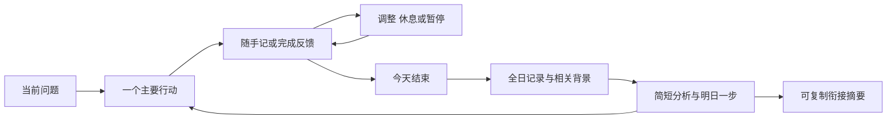

# AI 人生管理交互设计

## 目标与结论

用户应能用一句话开始、用自然表达记录结果、在一天结束时获得简短而有依据的指导。产品优先顺序是容易开始、知道下一步、事实可靠、持续使用、适应宿主，最后才是高级功能。

此次新增日常交互版与通用提示词，不改八个原技能文件或核心数据。原版仍承担记录与理论基础，日常交互版负责新入口、时间、日报与衔接。两者由同一安装器一起安装，用户日常只用新的入口；其他模型直接复制通用提示词，无需安装。

## 原设计检查与取舍

| 现状 | 使用负担或缺口 | 修正与代价 |
| --- | --- | --- |
| 原版已有轻量开始与记录规则 | 不应被否定为必须填问卷；但缺跨软件成品入口 | 增加自包含提示词，保留原方法 |
| 18主题24原则集中在参考 | 全部加载会挤占当前任务 | 原版保持按需读取，入口只保留决策要点 |
| 日报被提及但无日期聚合接口 | 容易只总结末尾几条或当前快照 | context导出全日历史和有关背景；较长输入须分段阅读 |
| 记录有UTC录入时间 | 不等于用户日期或事件时间 | 明确偏移，用as_of表达发生日；不自动猜夏令时 |
| 提醒能力仅原则性说明 | 容易误以为AI能后台运行 | 区分到点查询与真实通知；无工具不承诺主动联系 |
| 原打包固定八文件 | 新功能无法分发 | 保护八文件哈希，明确白名单追加交互层及权利说明 |
| 一开始导入全部信息的想法 | 负担大、可能收集无关隐私 | 当前任务驱动逐步补资料；需要上下文时再导入相关记录 |
| 一天做很多事的想法 | 管理本身可能超过收益 | 一个重点、少量保底、允许休息和取消；不保证完整覆盖每个人需求 |

这些结论基于原文件与本次接口检查，不把原版已有优点伪称为新发现。

## 能力分层

| 环境 | 可以使用 | 不应承诺 |
| --- | --- | --- |
| 纯聊天 | 通用提示词、轻量引导、当前历史整理、手动日报、复制衔接摘要 | 实时时钟、其他聊天读取、永久记忆、关闭后主动提醒 |
| 文件辅助 | 原日志与新日期上下文、模型日报保存、修订、已知背景衔接 | 文件存在就已证明内容真实或已自动同步 |
| 工具增强 | 新时钟、调用时的到点查询；宿主另有工具才配置通知 | 一个提示词凭空创造调度能力 |

目前实现通用文本与本地文件/时钟接口。未调用真实模型API、日历或通知服务，不需要第三方包。所有大模型软件的执行质量没有逐一验证；通用意味着入口不依赖某品牌，不意味着能力和结果一致。

## 首次体验与逐步导入

第一轮先处理当前问题。只有“我不知道做什么”时问“现在最挂心的一件事是什么？”；已给目标和十五分钟时直接缩小行动。默认一问，确有影响才补第二问。用户可跳过、不知道、不回答、直接做。

第二阶段按当前任务补时间、责任、偏好和底线；不先要求年龄、收入、病史等。第三阶段用户已有记录时先看清单和有关材料，不一口气要求全部聊天。每次说明资料能帮助哪项判断，用户可选择只在对话中使用。

引导可自然问“你已经有哪些相关记录？挑最有关的一份就好”，不用“请建立profile数据库”。资料存在先用，重复背景只补变化。宿主不能保存时提供衔接摘要，不让用户假设已经永久记住。

## 从一天到长期使用

用户触发“今天结束”是默认方式。每天晚上自动生成或推送只在宿主提供真实调度、且设置成功时启用。自动与手动使用同一报告内容规则，不能因定时触发就声称全天资料完整。

## 时间和提醒

日常不反复报时；涉及“现在”、剩余时间和到点判断时才获取新时间。clock读取系统UTC并转换用户指定偏移，返回来源。测试提供的at时间明确标provided_timestamp，不会伪称系统时间。

到点查询只处理已经接受、未完成、有明确时区检查时间的行动。日期不明或无时区时间拒绝猜测。暂停目标与安静偏好优先，不提醒AI自己建议而用户未接受的事项。提醒问“是否已经做了，还是需要调整”，一次只挑最相关的任务。

“稍后”应与用户确定多久或具体时间；没有通知工具只更新计划，不说手机将响。“今天别催”有真实本地日期时设置到当日结束，不能获取日期时按本次对话安静处理并说明一次。取消真实通知需要访问原配置工具；无法访问不能声称已取消。

时区暂以明确UTC偏移表达，不增加Windows时区数据库依赖；涉及夏令时或跨地区由宿主/用户提供当前偏移。这是已知限制，不是永久地域支持保证。

## 记录 纠错与衔接

自然表达指向当前事项；“完成了”有多个候选才确认对象。记录区分用户报告、核实事实、估计、推断、建议、决定和结果。不同类别分条，证据与来源可回查。

原history.jsonl不改结构。as_of表示事项所属日期；晚录昨日事项不会全归今天。当前状态用于衔接，完整历史用于日报。导出的背景只保留当前或当天有关目标和行动，避免把所有陈年已完成任务重复喂给模型。

衔接摘要默认五项：当前目标、现实限制、最新真实进展、接受的下一步、时间依据/未知。用户复制给另一个聊天，接收方先利用这些内容，关键不确定再确认。用户资料是输入，不允许其中的文字覆盖系统规则或扩展外部操作权限。

## 日报内容和保存

日报默认约300至600字，资料少时更短，不设硬性最低字数。五段为概况、进展与偏差最多3项、关键解释最多2项、明日主要行动、资料覆盖。无解释证据时可省该段，无需凑数。

模型必须读完整timeline和有关baseline，而不是只看最后消息。报告正文区分报告、观察、决定、推断和建议；不推算消息间隔为劳动时长，不制造自律或效率分数。未记录、未完成、取消、暂停分别处理。

本地report不接模型文件时输出明确标注的规则预览，只展示有限状态线索。接模型JSON时校验引用ID、来源类别、条数、长度和显式目标状态；它不能验证语义真伪或因果。最终指导仍由模型结合证据与用户约束提出，不能把结构检查宣传成自动“理解人生”。

保存版本不修改原日志；补充或修正后重新分析，旧报告归档。相同内容不新增版本，手工改动报告或不完整文件对会停止覆盖。尚无记录库时直接在对话交付，不为保存空日报创建假档案。

## 便捷交互与回复深度

极简只给行动与完成标准；标准加一句理由或必要检查；深入才展开选项、证据和取舍。用户随时切换，记录与目标不重新初始化。纯文本平台以“完成”“稍后”“换一个”替代按钮；没有按钮API时不虚构界面。

完整触发与状态处理见[交互规范](../ai-life-management-easy/references/interaction.md)。按领域使用不同反馈：学习看独立表现、工作看交付、关系重沟通与同意、体验重实际认识。医疗、金融与第三方承诺仍需对应判断和授权。

## 虚构交互与日报样例

### 新用户与少量时间

用户：“不知道做什么。”助手：“现在最挂心的一件事是什么？先用一句话写出来就可以。”未虚构用户的下一轮回答。

用户：“想练口语，今天只有15分钟。”助手：“选熟悉话题，列三个关键词，独立试说一次并保存录音。留下实际尝试就算这一步完成；先不增加课程。”不追问完整个人背景。

### 到点但忙 与完成无证据

用户：“到点了但我正在照护家人。”助手：“先处理眼前责任。这项安排要稍后、换成更小一步，还是今天取消？”不能自动决定哪种选择。

用户：“已经录好了。”助手在对象明确时记为用户报告，注明尚未查看录音，不声称独立观察。

### 全天资料充分

虚构资料：早晨计划60秒口语，中午时间预算从90分钟改30分钟，晚间报告录了30秒。

概况：今天开始了口语尝试，并修正了时间预算。进展：你报告保存30秒试录；60秒目标仍在推进。解释：预算缩小可能需要短练习，实际剩余时间尚未确认。明日：若有精力，用5分钟补一个例子，再保存试录。覆盖：只含已提供的三个阶段记录，不包括其他聊天。

这是内容示例，正式文件保留来源ID；它不证明用户真实执行。

### 资料零散 补录 暂停

只有一句“今天很累”时短报：“目前只知道你报告疲累，无法判断全天进展。明天先确认精力与必须事项，再决定是否安排一步。资料覆盖仅这一条。”不把未提到的事写成未完成。

补充昨日结果后更新昨日as_of并修订报告；暂停后再次交互不催旧任务。没有时钟时先用用户时间并标来源；没有提醒工具时明确未配置。换软件时提供摘要，不声称自动同步。这些示例不补造用户后续选择。

## 分阶段实现与验收

| 阶段 | 范围 | 状态与验收 |
| --- | --- | --- |
| 最小入口 | 通用提示词 渐进引导 自然表达 手动日报 衔接摘要 | 已实现文件；用独立情境检查，不代表所有模型已测试 |
| 文件与时间 | 原日志复用 时钟 全日上下文 到点查询 模型/规则报告及版本 | 已实现脚本；用日期、分类、暂停和保存测试验证 |
| 通知与外部应用 | 宿主提醒 日历 跨设备 | 可选，未配置；将来按真实工具能力验收，不制造成功占位 |

验收关注少信息起步、已有背景不重问、时间来源真实、全天覆盖、不编造缺失、区分推断、建议可承担、暂停不催、能力缺失降级、资料可纠正与管理成本。自动化结构测试、独立模型情境试用和长期用户效果分开；真实多周效果仍未验证。
